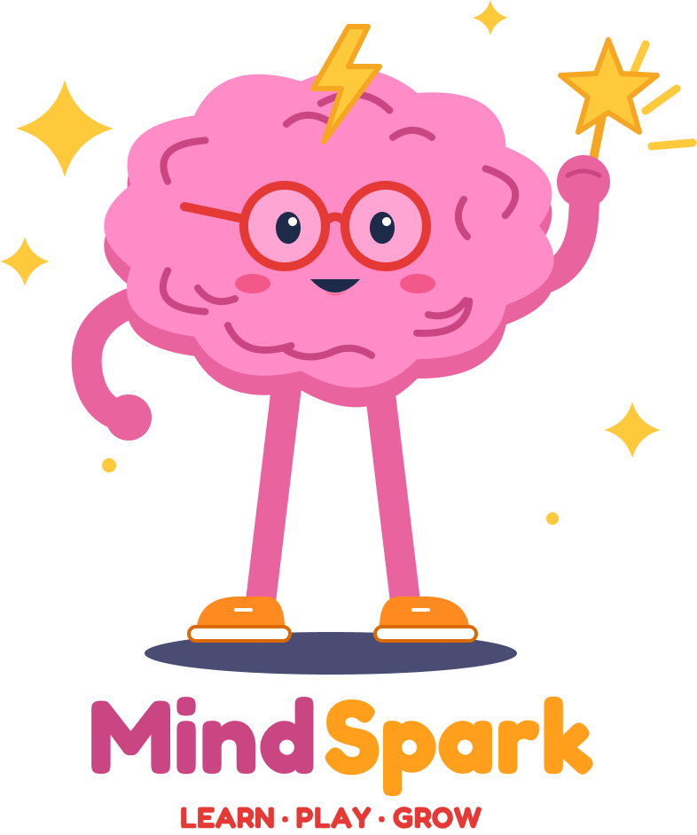

<div align="center">



### A brain-training app designed for children aged 6–12

Short, playful games that build memory, attention, logic and speed,
with clear instructions, helpful hints and rewards that keep kids coming back.

[**▶ Try the live prototype**](https://mahabindakhil.github.io/MindSpark-Project/)


</div>

---

## 📖 About

Children spend a large part of their free time on tablets and phones, but most games do little to exercise their thinking. Existing brain-training apps are built for adults: their instructions, visuals and difficulty don't suit children, who often struggle to use them alone and quickly lose interest.

**MindSpark** fills this gap. Children play short games, earn **sparks** ⚡ and spend them to unlock new games and customise their brain avatar. The goal is to keep them motivated, help them build thinking skills, and turn screen time into something fun *and* meaningful.

This repository contains the **high-fidelity interactive prototype**, developed as the term project for **CSC440 – Human-Computer Interaction** at **King Saud University**.

## ✨ Features

| | Feature | Description |
|---|---|---|
| 👋 | **Onboarding** | Splash screen, welcome and a personal profile with a nickname and avatar |
| 🏠 | **Home** | Greeting, sparks balance, daily streak, daily challenge and suggested games |
| 🎯 | **Daily Challenge** | A short series of rounds with rewards shown before starting |
| 🎮 | **Mini-games** | On-screen instructions, timer, pause and spark-based hints |
| 📚 | **How to Play** | Step-by-step tutorial before each game |
| 🪜 | **Levels** | Easy, Medium and Hard tiers with stars for each completed level |
| 🔓 | **Game Library** | Unlock new games with sparks, with a confirmation before spending |
| 🎁 | **Rewards** | Daily treasure chest and a Brain Shop with hats, glasses, poses, items, colours and themes |
| 🏅 | **Achievements** | Badges to earn and claim, with progress toward locked badges |
| 📊 | **My Progress** | Weekly activity chart, monthly play calendar and skill growth |

### 🕹️ Games

| Game | Skill | Unlock |
|---|---|---|
| Word Search | Language & attention | Free |
| Memory | Memory | Free |
| Math Dash | Speed & math | 300 ⚡ |
| Count the Blocks | Spatial reasoning | 500 ⚡ |
| Memory Matrix | Visual memory | 700 ⚡ |
| Ball Sort | Logic | 1000 ⚡ |

## 🎨 Design Approach

The screens were first designed in **Figma** as a full set of high-fidelity screens, covering the colours, mascot and layout of every page. The interactive prototype was then built from those designs.

The interface follows **Norman's design principles**: Visibility, Feedback, Constraints, Mapping, Consistency and Affordance. It was refined through interviews and usability testing with children.

## 🚀 Getting Started

No installation or build step is needed. The whole app is a single self-contained file: all styles, scripts and images are built into `index.html`.

**Option 1: online**
Open the [live prototype](https://mahabindakhil.github.io/MindSpark-Project/) in any modern browser.

**Option 2: locally**
```bash
git clone https://github.com/mahabindakhil/MindSpark-Project.git
cd MindSpark-Project
# then open index.html in your browser
```

> 💡 **Tip:** The prototype is designed for a phone screen. On a desktop, open your browser's developer tools and switch to a mobile view for the best experience.

Progress (sparks, unlocked games, badges) is saved in your browser, so each device starts fresh.

## 📁 Project Structure

```
MindSpark-Project/
├── index.html   # The complete app: HTML, CSS, JavaScript and images
├── assets/
│   ├── Mascot.png         # Mascot with logo (used in this README)
│   ├── Mascot pose.png    # Mascot reading pose
│   └── MindSpark LOGO.png # Wordmark
└── README.md
```

## 👥 Team (Group #8)

| Name |
|---|
| Anfal Alobeid |
| Maha Bin Dakhil |
| Reem Alsuhaibani |
| Reef Alqahtani |
| Ryoouf Alsuwidany |

## 🎓 Course

**CSC440 – Human-Computer Interaction**
Computer Science Department, College of Computer and Information Sciences
King Saud University · 1st Semester 1448 (2026)

---

<div align="center">


Made with 💜 for curious young minds

</div>
